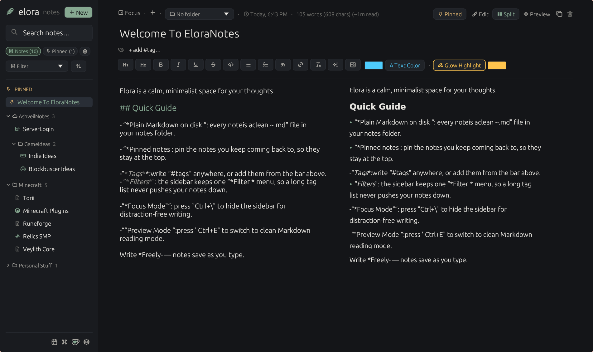

<div align="center">


# EloraNotes

**Notes on your disk. Shared notes on your server.**

A calm, keyboard-friendly Markdown notebook for Linux, macOS and Windows. Written in Rust, with no account and no cloud in the middle.

[](https://github.com/noxilith/EloraNotes/releases/latest) [](https://github.com/noxilith/EloraNotes/releases) [](LICENSE)
[](https://github.com/noxilith/EloraNotes/actions/workflows/ci.yml) [](https://noxilith.github.io/docs/)

[**Download**](https://github.com/noxilith/EloraNotes/releases/latest) · [**Documentation**](https://noxilith.github.io/docs/) · [**Shared notes**](https://noxilith.github.io/docs/#sharing)

</div>



## A notebook, not a platform

EloraNotes opens straight into your notes. There is no sign-up, no sync service and no database — just Markdown files in a folder you choose. What it does have is a fast editor, a sidebar that keeps up with a large notebook, and an optional server you can run yourself when you want to write with other people.

## Writing

- **Markdown, live.** Edit the source, read the rendered page, or put both side by side with `Ctrl+E` and `Ctrl+Shift+E`.
- **Formatting that stacks.** Bold, italic, highlight, strikethrough, code, text colours and headings combine in one run, so `**==this is bold inside a highlight==**` just works.
- **Pictures and tables.** Paste a screenshot, drop a file, or use the formatting bar. Drag a picture's corner to resize it, and write pipe tables whose columns align the way you asked.
- **Lists that behave.** Enter carries the quote and list markers onto the next line, and Tab indents the line or the whole selection.
- **A quiet place to type.** Focus mode hides everything but the page, and `Ctrl+F` finds a word without leaving the note.

## Keeping

- **A sidebar built for volume.** Each note is a single line — icon and title — with folders that fold, tags, pins, a trash you can restore from, and search across the whole vault.
- **Everything within reach.** `Ctrl+K` opens the command palette and quick switcher, `Ctrl+D` opens today's daily note, and meeting and project templates are one command away.
- **Connections, not just pages.** `[[Wiki links]]` and backlinks tie notes together, the note graph draws the shape of those links — linked notes gather into coloured clusters, notes nothing links to wait on an arc below, and you can zoom, drag and fit it to the window — and a report lists every link that leads nowhere.
- **Your notes can leave.** Export one note or the whole vault as standalone HTML pages, or import a folder of Markdown files.

## Sharing

Point the app at an EloraNotes server and its notes join your sidebar. Everyone in a note sees everyone else's edits as they happen, with a coloured caret and a name tag at each cursor.

- A note can be open to **everyone** on the server, closed to **only you**, or shared with **named people**.
- Access follows a secret identifier, not the display name somebody typed, so changing your name never hands you someone else's notes.
- Pictures in a shared note are stored on the server too, so they stay put after the person who added them disconnects.

The server is a small binary with an installer for Linux and Windows. It speaks TLS and pins its certificate on the first connection — [the manual covers hosting, identity and privacy](https://noxilith.github.io/docs/#server).

To host one, download the installer from the [latest release](https://github.com/noxilith/EloraNotes/releases/latest): `install-elora-server.sh` on Linux (`sudo bash install-elora-server.sh`) or `install-elora-server.ps1` on Windows (from an Administrator PowerShell: `powershell -ExecutionPolicy Bypass -File .\install-elora-server.ps1`). It asks for a name, a port and a password, installs the server as a service that starts at boot, opens the port in the firewall and checks that the server is really answering. Run it again to update (your settings, password, notes and certificate are kept), reconfigure or uninstall. It verifies the download against the release's checksums, and a scripted install can pass its answers in `ELORA_NAME`, `ELORA_PORT` and `ELORA_PASSWORD`.

## Working with AI assistants

EloraNotes is its own [MCP](https://modelcontextprotocol.io) server, so Claude or any other MCP client can read, search, write and link your notes — on this computer and in the shared library — without a plugin.

- **One click.** Settings → *AI assistants* finds the AI apps on your computer (Claude Desktop, Claude Code, Cursor, VS Code, Windsurf, Gemini CLI, Codex) and adds EloraNotes to them with a button, without you editing a config file. Nothing is changed until you press it (a few seconds after launch it only looks, and says so if an app still starts an older or different copy of EloraNotes, with one **Update all** button in Settings), other settings in the app's file are kept, and a copy of the old file is saved first. For any other app there is the command to copy (`elora --mcp`), a JSON config to copy, and a **Test connection** button that starts the server and asks it a question.
- **A memory bank.** Settings → *Memory bank* adds a small skill that teaches an assistant to keep its long-term memory in your notes: preferences, project facts and decisions, saved as short notes in an `AI Memory` folder with an index, and recalled only when they help. It installs for Claude Code and for Codex, Gemini CLI and Cursor; for Claude Desktop and claude.ai it saves a `.zip` to upload under *Customize → Skills*. You can read, edit or delete every memory like any other note.
- **It shows up as it happens.** Notes an assistant writes appear in the sidebar and in the open window immediately, wear a robot icon, and have their own filter beside *Pinned*.
- **You decide what it may touch.** Mark any note *Assistants can read, not change* from the robot menu above it. The server can also be started with `--read-only`, `--folder <name>` to show it one folder, or `--no-shared` to leave the shared library out.
- **A way back.** Before an assistant overwrites or deletes a note, the old text is kept in a hidden `.history` folder (the last 20 versions). The robot menu lists them and restores one.

An assistant reaches the shared library as you: it uses your saved name, identifier and password, so it can do what you can there. A note's read-only mark for the shared library is kept on this computer only.

## Yours

- **Plain files.** Every note is a `.md` file with light YAML frontmatter, in `Documents/EloraNotes` unless you point it elsewhere with `--dir` or `ELORA_NOTES_DIR`.
- **Five themes.** Obsidian, Paper, Nordic, Matcha, or Matugen to pull colours from your wallpaper.
- **Keeps itself current.** EloraNotes checks GitHub for a newer release and updates the way it was installed, then restarts.

## Download

Grab the build for your platform from the [latest release](https://github.com/noxilith/EloraNotes/releases/latest).

| Platform | Installer | Portable |
| :--- | :--- | :--- |
| **Linux** | Flatpak | AppImage or tarball |
| **Windows** | `-setup.exe` | `-portable.exe` |
| **macOS (Apple Silicon)** | `.dmg` | `.zip` with `EloraNotes.app` |

The Flatpak is self-hosted rather than published to Flathub, so updates arrive through the app rather than `flatpak update`.

## Documentation

The full manual — every view, every setting, the complete Markdown dialect, server setup and a FAQ — lives at **[noxilith.github.io/docs](https://noxilith.github.io/docs/)**.

- [Getting started](https://noxilith.github.io/docs/#getting-started)
- [Markdown reference](https://noxilith.github.io/docs/#markdown)
- [Pictures and tables](https://noxilith.github.io/docs/#pictures)
- [Wiki links, backlinks and the graph](https://noxilith.github.io/docs/#links)
- [Shared notes](https://noxilith.github.io/docs/#sharing) and [who can see a note](https://noxilith.github.io/docs/#privacy)
- [Hosting a server](https://noxilith.github.io/docs/#server)
- [Keyboard shortcuts](https://noxilith.github.io/docs/#shortcuts)
- [Install and uninstall](https://noxilith.github.io/docs/#install)

## Run from source

```bash
git clone https://github.com/noxilith/EloraNotes
cd EloraNotes
cargo run --release
```

On Linux, NixOS and macOS, `./run.sh` sets up the environment first. The collaboration server builds without the GUI libraries:

```bash
cargo build --release --no-default-features --bin elora-server
```

## License

EloraNotes is licensed under the GNU General Public License v3.0 or later. See [LICENSE](LICENSE). Bundled fonts keep their own licenses: [DejaVu](assets/DejaVu-LICENSE.txt) and [Tabler Icons](assets/TABLER-ICONS-LICENSE.txt).
